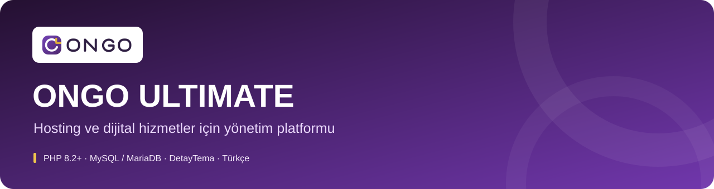
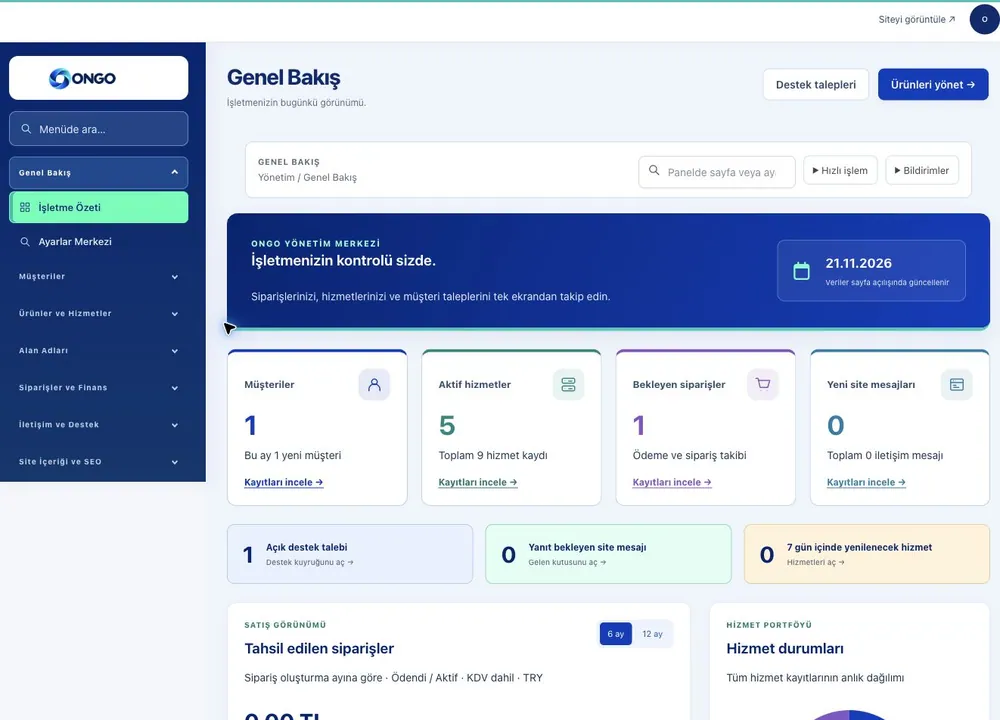
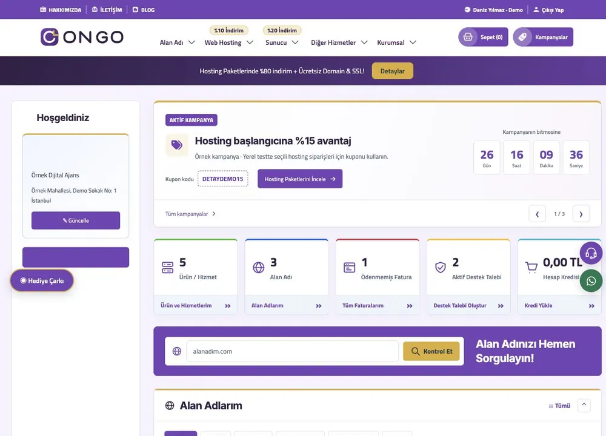

<p align="center"></p>

<p align="center">
<a href="https://demo.ongo.com.tr/">Canlı demo</a> · <a href="https://kayit.ongo.com.tr/">Tanıtım ve lisans</a> · <a href="https://kayit.ongo.com.tr/lisans-olustur">Lisans oluştur</a> · <a href="https://github.com/HezarfeN06/ongo-ultimate/releases/latest">Güncel sürüm</a> · <a href="https://kayit.ongo.com.tr/rehber">Görsel rehber</a>
</p>

<p align="center">


</p>

# ONGO Ultimate

**Hosting, alan adı, sunucu, yazılım ve dijital ürün satan işletmeler için PHP tabanlı satış ve müşteri yönetim platformu.**

ONGO Ultimate; hizmet kataloğunu, siparişleri, faturaları, müşteri hizmetlerini ve destek görüşmelerini aynı sistemde toplar. Markanıza ait web sitesi, müşteri paneli ve yönetim paneli birlikte çalışır. DetayTema ile logo, renk, paket içeriği, rozetler ve sayfa içerikleri yönetimden düzenlenebilir.

Bu depo ONGO Ultimate'in **resmî dağıtım ve Türkçe dokümantasyon alanıdır**. PHP uygulama dosyalarını içeren tam kurulum paketi [Releases](https://github.com/HezarfeN06/ongo-ultimate/releases) bölümünde `ongo-ultimate.zip` adıyla yayımlanır. Kurulum için alan adına bağlı ONGO lisansı gerekir.

## Önce deneyin

| Bağlantı | Ne bulabilirsiniz? |
|---|---|
| [demo.ongo.com.tr](https://demo.ongo.com.tr/) | Örnek ürünlerle web sitesi, müşteri deneyimi ve yönetim alanı |
| [kayit.ongo.com.tr](https://kayit.ongo.com.tr/) | Özellikler, entegrasyonlar, lisans ve kullanım rehberleri |
| [Lisans oluştur](https://kayit.ongo.com.tr/lisans-olustur) | Üyelik ve 365 günlük alan adı lisansı |
| [Hesabım / İndirmeler](https://kayit.ongo.com.tr/hesabim/indirmeler) | Üyeler için güncel kurulum paketi |
| [Lisans doğrulama](https://kayit.ongo.com.tr/lisans-dogrula) | Yalnız alan adıyla durum ve süre sorgulama |

### Canlı demo hesapları

| Alan | E-posta | Şifre | Giriş |
|---|---|---|---|
| Müşteri paneli | `user@ongo.com.tr` | `demo123` | [Müşteri girişi](https://demo.ongo.com.tr/musteri-girisi) |
| Yönetim paneli | `admin@ongo.com.tr` | `demo123` | [Yönetici girişi](https://demo.ongo.com.tr/yonetim-paneli) |

Demo hesapları örnek kayıtları incelemek içindir. Gerçek ödeme, gönderim ve hizmet işlemleri kapalıdır. GitHub'daki gerçek kurulum paketi bu ortak demo hesaplarını oluşturmaz.

## Neler yapabilirsiniz?

| Alan | Kullanım |
|---|---|
| **Hosting ve sunucu** | Paket, dönem fiyatı, lokasyon, özellik ve müşteri hizmet kayıtlarını yönetin. |
| **Alan adı** | Alan adı sorgulama, WHOIS, uzantı fiyatları ve müşteri alan adlarını takip edin. |
| **Yazılım ve dijital ürün** | Görselleri, açıklamaları, özellikleri, lisans seçeneklerini ve satış dönemlerini düzenleyin. |
| **Sipariş ve tahsilat** | Sepet, sipariş, fatura, ödeme bildirimi ve müşteri bakiyesini ilişkilendirin. |
| **Müşteri alanı** | Hizmetler, alan adları, faturalar, destek talepleri ve hesap bilgilerini müşteriye sunun. |
| **Destek ve iletişim** | Destek taleplerini, canlı destek alanını ve bildirim ayarlarını yönetin. |
| **Tema ve içerik** | Logo, favicon, renkler, menüler, rozetler, paket sunumları, SSS, blog ve duyuruları düzenleyin. |
| **Kampanyalar** | Kampanya içeriklerini, kuponları ve ilgili vitrin alanlarını yapılandırın. |

53 başlangıç ürünü, düzenlenebilir başlangıç içerikleri, DetayTema ve yönetim alanları pakete dahildir. Gerçek tahsilat ve hizmet açma işlemleri için kendi sağlayıcı hesaplarınızı yapılandırmanız gerekir.

WHMCS veya WISECP gibi hosting otomasyonu ürünlerini değerlendiriyorsanız ONGO Ultimate'in kapsamını [canlı demo](https://demo.ongo.com.tr/) ve [gerçek ekranlarla hazırlanan rehber](https://kayit.ongo.com.tr/rehber) üzerinden inceleyebilirsiniz.

## Ekranlardan birkaç örnek

### Markanıza ait web sitesi


### Yönetim paneli


### Müşteri paneli


Ekranlar örnek kurulumdan alınmıştır; içerikler yönetim ayarlarınıza göre değişebilir. [Web sitesi rehberi](https://kayit.ongo.com.tr/rehber/web-sitesi) ve [yönetim paneli rehberi](https://kayit.ongo.com.tr/rehber/yonetim-paneli) ayrı ayrı incelenebilir.

## Entegrasyonlar

| Grup | Sunulan entegrasyonlar |
|---|---|
| Hosting panelleri | WHM / cPanel, Plesk, DirectAdmin |
| Alan adı | DomainNameAPI, ResellerClub, GoDaddy |
| Sunucu | Hetzner Cloud, SolusVM, DiyoVM |
| Oyun sunucusu | Pterodactyl |
| Ödeme | PayTR, iyzico, Shopier, PayPal |
| Muhasebe | Paraşüt, BizimHesap |
| SMS ve bildirim | ONGO SMS, Mutlucell, Netgsm, İleti Merkezi |

Desteklenen işlemler ve hesap gereksinimleri sağlayıcıya göre değişir. Üçüncü taraf aboneliği, API yetkileri, ülke desteği ve test hesabı gerekebilir. [Entegrasyon rehberlerini inceleyin](https://kayit.ongo.com.tr/entegrasyonlar).

## Kurulum

1. [Kayıt portalında](https://kayit.ongo.com.tr/lisans-olustur) hesabınızı ve kuracağınız alan adına ait lisansınızı oluşturun.
2. [Güncel sürümden](https://github.com/HezarfeN06/ongo-ultimate/releases/latest) `ongo-ultimate.zip` dosyasını indirin. İsterseniz [hesabınızın indirme alanını](https://kayit.ongo.com.tr/hesabim/indirmeler) kullanın.
3. HTTPS alan adınızı ve boş MySQL / MariaDB veritabanınızı hazırlayın. ZIP içeriğini sitenin web köküne çıkarın.
4. `https://alanadiniz.com/install.php` ekranını açın. Veritabanı bilgileri, lisans anahtarı, yönetici e-postası ve şifresini girin.
5. Yönetim panelinde firma bilgilerinizi, logoyu, ürünleri ve sağlayıcı bağlantılarını düzenleyin.

Site adresi otomatik algılanır. Kurulumda SMTP, telefon veya sağlayıcı hesabı istenmez. Lisans adımı atlanamaz; alan adı eşleşmesi ve ilk çevrimiçi doğrulama gerekir.

### Sunucu gereksinimleri

- PHP **8.2 veya üzeri**
- MySQL / MariaDB ve boş kurulum veritabanı
- PDO MySQL, cURL, OpenSSL, mbstring, DOM, fileinfo ve Session
- HTTPS sertifikası ve lisans merkezine dış HTTPS erişimi
- Uygulamanın kurulum ve çalışma dizinlerine gerekli yazma izinleri

PHP 8.2.32 ve 8.4.23 üzerinde sözdizimi ve demo yönetim girişi kontrolleri yapılmıştır. PHP 8.2 üzerinde yeni kurulum senaryoları doğrulanmıştır. [Ayrıntılı kurulum rehberi](docs/KURULUM.md).

## Lisans ve kullanım

- Yeni lisanslar **365 gün** için oluşturulur; yönetici onayı beklenmez.
- Kayıt portalında tam kodunuz **Lisans kodlarım** alanında görünür.
- Bireysel hesapta aynı anda en fazla **5 proje lisansı** tutulabilir. Aynı alan adına ayrı kurulumlar için birden fazla kod oluşturulabilir.
- Normal kurulum alan adı ve kurulum kimliğiyle eşleştirilir. Çalışan kurulum normalde 24 saatte bir merkeze bağlanır.
- Ağ hatası tek başına çalışan siteyi kapatmaz; son geçerli imzalı aktif karar kullanılır. Alınan imzalı askı veya iptal kararı uygulanır.
- Zorunlu **[Powered by ONGO](https://ongo.com.tr/)** atfı ve dağıtım bütünlüğü denetimleri korunmalıdır.

[Lisans akışı](docs/LISANS.md) · [Kullanım koşulları](LICENSE.md) · [Lisans doğrulama](https://kayit.ongo.com.tr/lisans-dogrula)

## Güncelleme ve dosya doğrulama

ZIP'in SHA-256 özeti sürüm sayfasındaki `SHA256SUMS.txt` dosyasında bulunur:

```sh
# macOS
shasum -a 256 ongo-ultimate.zip

# Linux
sha256sum ongo-ultimate.zip
```

Güncellemeden önce dosya ve veritabanı yedeğinizi alın. Mevcut `config.php`, çalışma zamanı lisans dosyaları, yüklemeler ve `.user.ini` dosyasını koruyun. Kurulu sitede `install.php` çalıştırmayın. [Güncelleme adımları](docs/GUNCELLEME.md).

## Dokümantasyon ve topluluk

- [Başlangıç ve kurulum](docs/KURULUM.md)
- [Yönetim paneli](docs/YONETIM-PANELI.md)
- [Müşteri paneli](docs/MUSTERI-PANELI.md)
- [Lisans, proje ve alan adı yönetimi](docs/LISANS.md)
- [Sürüm notları](CHANGELOG.md)
- [Katkı ve hata bildirimi](CONTRIBUTING.md)
- [Güvenlik bildirimi](SECURITY.md)
- [Görsel rehberler](https://kayit.ongo.com.tr/rehber)
- [Hesabınızdan destek talebi](https://kayit.ongo.com.tr/hesabim/destek)

Hata bildirirken sürüm, PHP sürümü ve tekrar üretme adımlarını paylaşın. Parola, API anahtarı, lisans kodu veya müşteri verisi içeren kayıtları herkese açık issue içine eklemeyin.

---

**Geliştirici:** [Ahmet Alpdağtaş](https://github.com/HezarfeN06) · **ONGO Yazılım Çözümleri**

[ongo.com.tr](https://ongo.com.tr/) · [Canlı demo](https://demo.ongo.com.tr/) · [Kayıt ve lisans](https://kayit.ongo.com.tr/)
